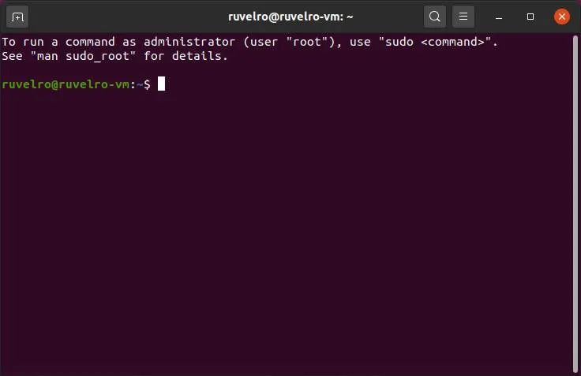

# Administración de Sistemas en IES Clara del Rey

## Guía Práctica de Iniciación a Linux y Markdown

El ciclo formativo de **Administración de Sistemas Informáticos en Red** requiere un dominio sólido de herramientas de documentación como *Markdown* y lenguajes de scripting como `bash`. La correcta estructuración de la información facilita la colaboración en equipos técnicos y la automatización de despliegues.

### Elementos de Configuración del Servidor

* Actualización de paquetes del sistema
* Configuración de interfaces de red virtuales
* Restricciones de tráfico con cortafuegos

1. Clonar el repositorio oficial del proyecto
2. Crear la estructura de directorios requerida
3. Validar la sintaxis de los ficheros de configuración

```bash
#!/bin/bash
echo "Actualizando listas de paquetes..."
sudo apt update && sudo apt upgrade -y
echo "Sistema actualizado correctamente."
Para ampliar información sobre los módulos del ciclo, puedes consultar la [web oficial de educación](https://www.comunidad.madrid) o revisar los [detalles técnicos internos](docs/detalles.md).

### Recursos Gráficos

Imagen local almacenada en el repositorio:


Imagen externa desde Wikimedia Commons:


Comparativa de Servicios en Red

| Servicio | Puerto Predeterminado | Protocolo |
| :--- | :--- | :--- |
| SSH | 22 | TCP |
| HTTP | 80 | TCP |
| DNS | 53 | UDP/TCP |
